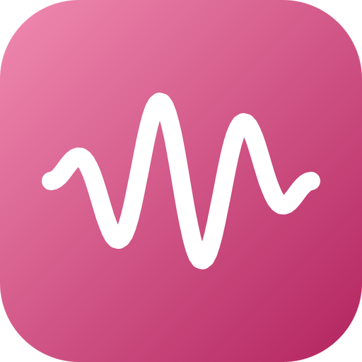

# go-dsp — brand assets

Official logos for the **go-dsp** organization.

The mark is a signal: a tone of three periods under a Hann window, the burst a
filter or a spectral estimator is handed. The trace is computed by
`mark/main.go` from a formula, not drawn. Its gradient (`#F08AB0` to `#B3245F`)
is a rose that sets go-dsp apart from the violet of go-numerics, the emerald of
go-ndarray and go-fft, and go-plot's blue; its dark end reads on white at
6.30:1 and its light end on a dark page at 8.25:1.

## Formats

- **SVG** — `svg/color`, `svg/white` (white, transparent), `svg/black` (black, transparent)
- **PNG** 16→1024 px, 3 variants — `png/<variant>/<size>/`
- **JPG** (color, white background) — `jpg/<size>/`
- **ICO** (Windows) — `ico/`
- **ICNS** (macOS) — `icns/`
- **GitHub avatar** 512 px — `avatar/`
- **Social preview** 1280×640 (repo banner) — `social/`

`check/kit.py` counts the whole matrix on every pull request, and the `mark`
job writes `svg/color/go-dsp.svg` again from `mark/main.go` and fails if a byte
differs.

---
*Generated from `svg/color/go-dsp.svg` by the fleet's Go brand pipeline (brandgen) — rounded square badge, line glyph, color / white / black variants.*
